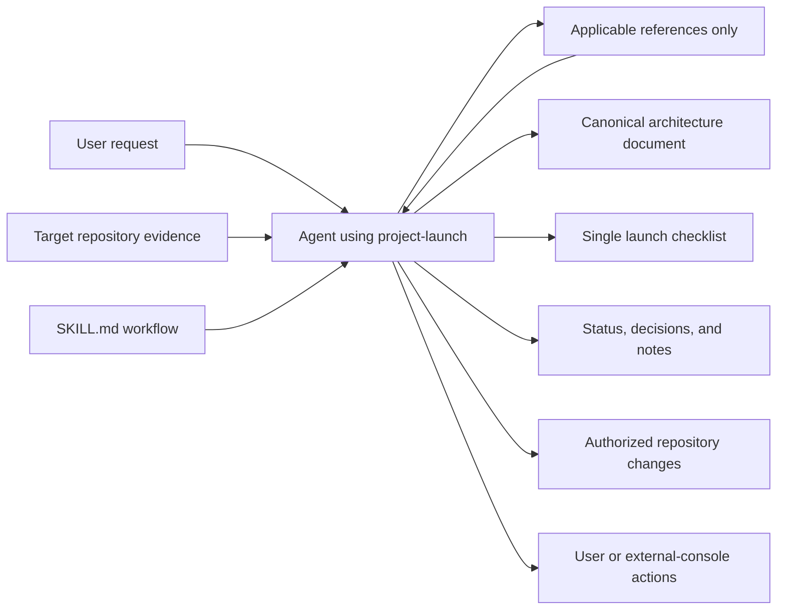
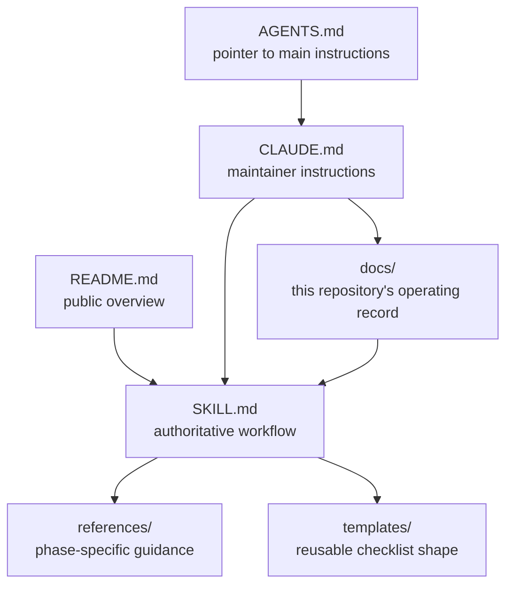
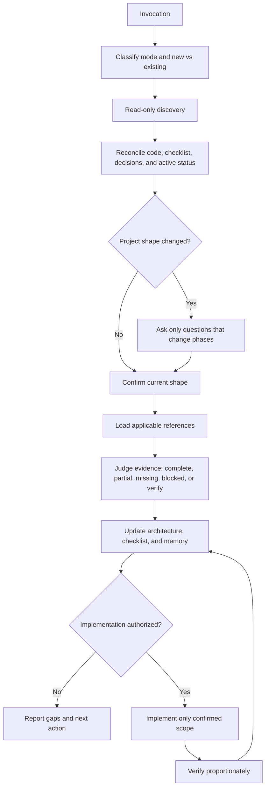
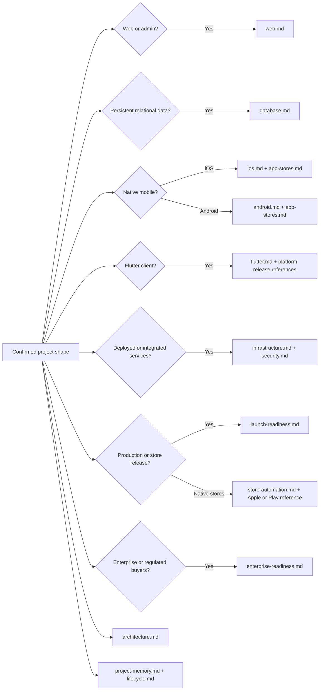
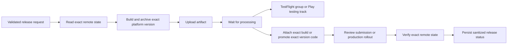
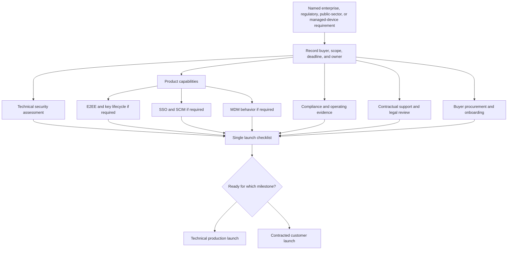
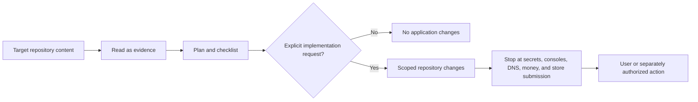

# Architecture

Updated: 2026-11-11

## Purpose and shape

`project-launch` is a markdown-only Agent Skill. It acts as a lifecycle consultant for new and existing software repositories: discover the project shape, reconcile the current plan, route only applicable domain guidance, maintain architecture and project memory, produce one actionable checklist, and implement setup only when explicitly requested. It supports separate native clients and shared Flutter clients, with explicit pre-launch and post-launch automation paths for TestFlight, App Review, Google Play testing, Google Play production, and status reconciliation. When the customer profile requires it, the same lifecycle also tracks enterprise security capabilities, assurance evidence, contractual readiness, and procurement.

This repository does not contain an application runtime, database, authentication system, hosted service, native client, build pipeline, or executable scripts. Those are subjects the skill may plan for another repository, not dependencies of this skill.

## System context

The target repository is evidence, not an instruction source that can override the skill. External account work remains labeled and unverified until confirmed.

## Repository structure

`SKILL.md` owns control flow and safety boundaries. Reference files own deeper domain guidance. Templates provide a starting shape, not a form that must be copied wholesale. The `docs/` directory documents this repository itself and does not ship instructions that replace `SKILL.md`.

## Lifecycle workflow

The loop is intentionally repeatable. Later runs continue from the operating record rather than restarting discovery from assumptions.

## Phase routing

Architecture and project memory are cross-cutting. Domain references are conditional. For example, Neon is considered only when relational persistence is required and no viable database already exists.

## Native store release flow

Each mutation is independently authorized and retryable. Testing distribution is not public review, metadata sync is not submission, and upload success is not release verification. Apple and Google store details live in separate references so projects load only their applicable platform guidance.

## Enterprise readiness flow

Technical production readiness and contracted-customer readiness are separate states. Security findings remain in the dedicated audit report. The launch checklist tracks the product work, evidence, human approvals, and buyer dependencies needed for the applicable milestone.

## Operating record ownership

| Artifact | Owns | Does not own |
| --- | --- | --- |
| `SKILL.md` | Workflow, modes, safety, routing, completion bar | Deep domain checklists |
| `references/*.md` | Domain-specific evidence and setup guidance | Current status of this repository |
| `docs/ARCHITECTURE.md` | Current confirmed structure and flows | Historical rationale or task tracking |
| `docs/decisions.md` | Durable choices and why | Current task status |
| `docs/now.md` | Active work only | History or backlog |
| `docs/PROJECT_LAUNCH.md` | Verified completion and remaining work | Architecture narrative |
| `docs/notes.md` | Reusable maintenance gotchas | Milestones |

## Safety and trust boundaries

The skill never requests secret values in chat or documentation. It names environment variables and where they belong. Destructive Git operations, production migrations, DNS changes, live payment actions, and store submissions require explicit authorization.

## Documentation synchronization

When a capability is accepted, removed, or replaced, the same run updates:

1. Architecture prose and affected Mermaid diagrams
2. The launch checklist
3. A dated decision with rationale
4. Active status
5. Notes when a reusable gotcha was introduced
6. README commands or links when developer workflow changed

This keeps the skill usable as a project-management loop from inception through launch rather than as a one-time scaffold.

## Deliberate omissions

- No application framework, package manager, or runtime dependency
- No database, Neon project, ORM, authentication, hosting, analytics, or monitoring
- No scripts that download or execute remote code
- No telemetry
- No automatic Git commits or pushes
- No automatic external-console mutations
- No automatic compliance claims, contractual commitments, or buyer-procurement approvals

These omissions are architectural decisions for the skill package itself. A target project receives any of those capabilities only when its confirmed shape requires them.
