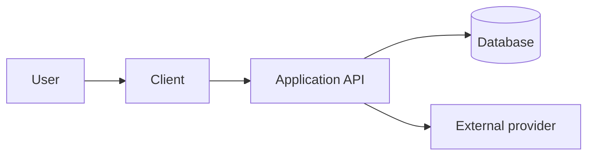

# Architecture documentation

Every software repository should have one canonical architecture description that is proportionate to its shape. Reuse an existing architecture document when it already serves that purpose. Otherwise create `docs/ARCHITECTURE.md`.

The document explains the system that exists or has been accepted in the current plan. It is not a catalog of technologies the project might use later.

## Inspect before writing

Derive the architecture from confirmed evidence:

- Application entry points, packages, and workspace boundaries
- Client surfaces and the backend or API they call
- Data stores, migration tooling, file storage, and queues
- Authentication and authorization boundaries
- Enterprise identity, device-management, encryption, and customer trust boundaries when applicable
- External providers and webhooks
- Environment and deployment configuration
- CI/CD and release destinations
- Recurring jobs and the one scheduler that owns each job
- Existing architecture decision records and diagrams

Do not infer a deployed service from an installed package. Mark console-only state as `NEEDS VERIFICATION` in the launch checklist rather than drawing it as confirmed.

## Required content

Keep the document concise enough to remain useful. Include only applicable sections:

1. Purpose and current project shape
2. System boundaries and primary components
3. Repository or monorepo structure
4. Runtime request and data flows
5. Authentication and authorization boundaries
6. Data ownership, migrations, storage, and retention
7. External integrations
8. Local, development, preview, staging, and production environments that actually exist or are accepted in the plan
9. Deployment, release, rollback, and recurring-job ownership
10. Security and secret boundaries
11. Enterprise identity, E2EE key flow, managed-device behavior, and evidence boundaries when applicable
12. Deliberate omissions and unresolved architecture decisions

Use links to detailed runbooks instead of duplicating their contents.

## Mermaid diagrams

Use Mermaid when it makes relationships or sequence clearer. Prefer the smallest useful set:

- **System context or component flow** for every non-trivial project
- **Deployment/environment flow** when more than one runtime or environment exists
- **Data or authentication sequence** when a flow crosses three or more boundaries
- **Key lifecycle or enterprise identity flow** when E2EE, SSO, or SCIM is in scope
- **Release flow** when web, API, or store destinations have conditional dependencies
- **Repository map** for a monorepo with several deployable packages

Use stable node labels and simple syntax that common Markdown renderers support. Avoid decorative diagrams. Every node must correspond to confirmed code, configuration, an accepted plan decision, or an explicitly labeled external/manual dependency.

Example structure, adapted to the actual project:

Do not copy that example into a repository whose project shape does not include an API or database.

## Keep the documents aligned

When the plan or implementation changes architecture, update in the same run:

- The canonical architecture document and affected diagrams
- The launch checklist
- The dated decision entry explaining why
- Active status
- Notes when the change creates a reusable operational gotcha
- README links or commands when the developer workflow changed

The architecture document owns current structure. The decision log owns why choices were made. The launch checklist owns remaining work. Active status owns what is happening now. Do not make any of them duplicate the others.

## Audit judgment

| Evidence | Status |
| --- | --- |
| Canonical document matches code/config and diagrams show current boundaries | Complete |
| Document exists but omits an implemented surface, environment, or integration | Partially complete |
| Several architecture files conflict and none is canonical | Partially complete |
| No architecture document for a multi-component project | Missing |
| Small single-surface project has a concise, accurate architecture section in its README | Complete; do not create another file |
| Vendor or production state cannot be proven from the repository | Needs verification in the checklist |
